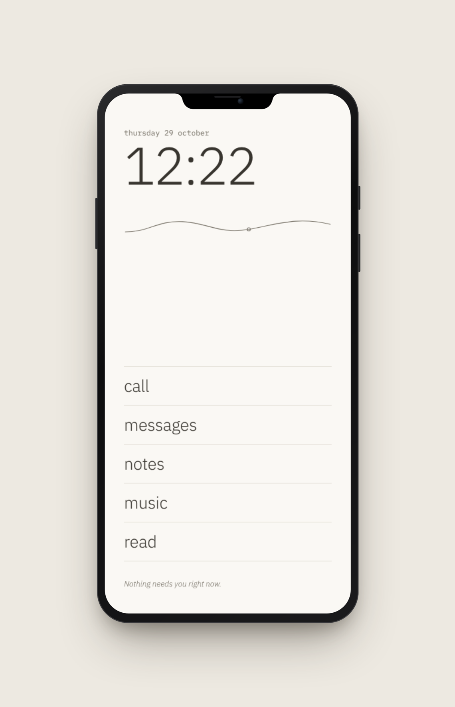

I'm building my own phone, well no, my own OS for my phone, well no, that's also not it technically. What I'm building is my own phone experience, one that is aligned with the way I want to live.

You see, I’m a sucker for carbs, if you're like me you'll understand... Whenever I pass by a bakery and sense the smell of freshly baked medialunas, I just want to have one. Sometimes I just give in to temptation and get myself one, no biggie, sometimes I just enjoy the smell and keep walking, I know the smell won't reach me for long, so I'll just forget about it. Something similar happens with my phone, but it is much more subtle and the temptation, unlike the medialunas' smell, never goes away. Even worse, I can pull it and "have a bite" of it without almost even noticing. Well, I don't wanna be a victim of my stealing-attention phone anymore so I have decided to help my will power by not carrying it, after all it is not a fair battle, this phone has been engineered to steal my attention, attention is a commodity for them.

So, how do I keep living in a world that is all about connectivity and apps without a phone? Well, part of that is renouncing some of this, and I have decided to do that with apps like Instagram, What's App, X, Hinge, even Linkedin. But there are other things that are truly convenient about my phone, like being able to listen to music, I don't wanna give up on that and become a complete caveman, at least not yet... So, I decided to create my own phone experience, for that I bought a cheap One Plus 6 that can run [Nura](https://nura.eco), the most mature linux distribution that runs on phones that I could find. On top of it, I'm running my own shell, that only gives me access to a bunch of things that I wanna have on my pocket. The best part is that I have complete control over this, so I can add or remove whatever I want, change things as I change my mind and test the experience. It's a fun thing to do, it takes some effort, but I enjoy it.

